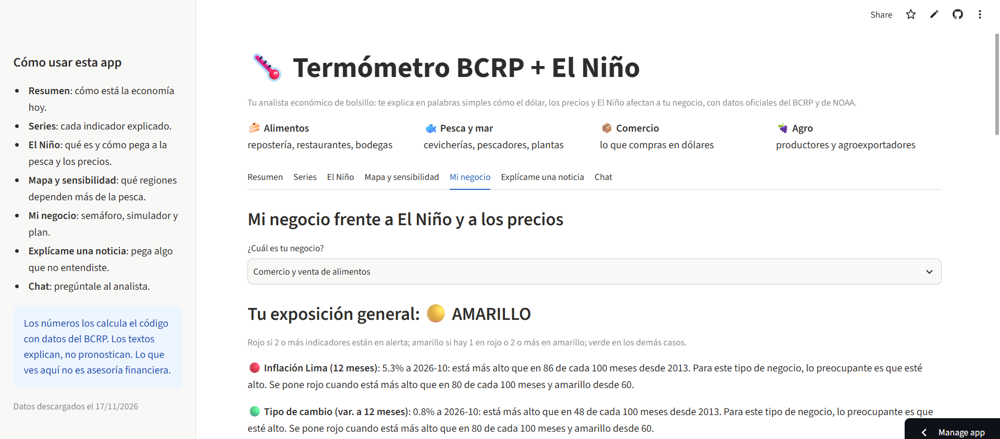
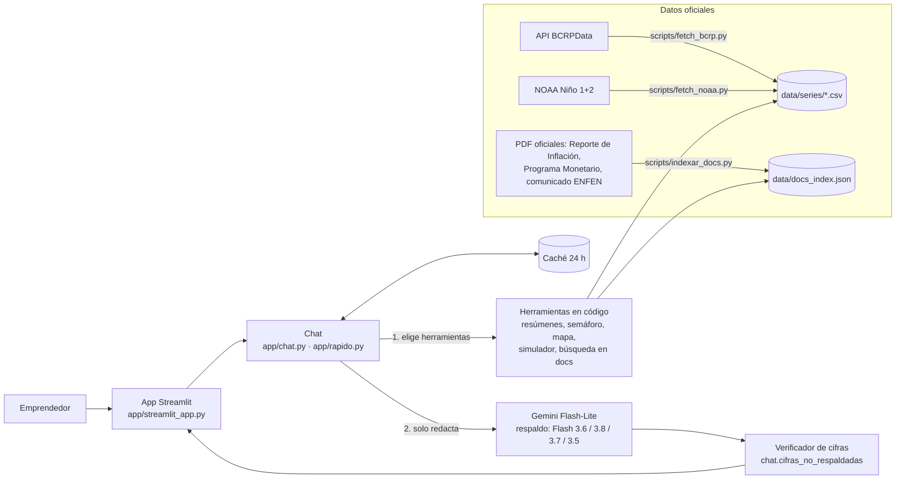

# Termómetro BCRP + El Niño

> **Hacemos que los emprendedores peruanos entiendan en 1 minuto cómo el dólar, los precios y El Niño afectan su negocio, mediante un analista con IA que solo responde con datos oficiales del BCRP y de NOAA, y que verifica cada cifra.**

**Demo:** https://2bcqbjxapphgmsq5tw6jj5s.streamlit.app/ · o en local: ver [Cómo correrlo](#cómo-correrlo) · **Video de respaldo:** [ver en Google Drive](https://drive.google.com/drive/folders/1fQaLxJStzNHUti3afEh1gxOjh0AQ-qXs?usp=sharing)

---

## 1. One-liner

Hacemos **un analista económico de bolsillo** para **emprendedores y trabajadores de los sectores más expuestos al dólar, los precios y El Niño** (alimentos, pesca, comercio y agro) mediante **un chat con IA conectado a las series oficiales del BCRP y a la temperatura del mar de NOAA**, que explica en lenguaje simple qué significa cada dato para su margen.

## 2. Founder

**Carla Bocanegra**, estudiante de Economía en la Universidad del Pacífico e hija de dos padres emprendedores.

En el mundo corporativo, donde trabajo, las decisiones se toman con analistas que explican qué significan el dólar, la inflación o las tasas. Mis padres, como la mayoría de emprendedores, no tienen ese analista, y les cuesta entender cómo las variables económicas y fenómenos como El Niño afectan su negocio. Este proyecto busca darles esa explicación completa y sencilla, y la intuición que necesitan, para que tomen decisiones informadas.

## 3. Problema

**Quién lo sufre.** El emprendedor que decide precios, compras e inventario sin saber leer un reporte del BCRP y sin un analista. Nos enfocamos en los 4 sectores donde estos choques pegan más fuerte y donde la app ya trae un semáforo específico:

| Sector | Ejemplos | Qué le pega | Semáforo de la app |
|---|---|---|---|
| 🍰 **Alimentos** (usuario principal) | Repostería, restaurantes, cevicherías, bodegas | Precios de insumos (mantequilla, huevo, chocolate), calor de El Niño en el delivery | Comercio y venta de alimentos |
| 🐟 **Pesca y mar** | Pescadores, plantas de harina, proveedores del norte | La anchoveta cae con El Niño (−73 % este año) | Pesca y harina de pescado |
| 📦 **Comercio** | Quien compra mercadería, cajas o empaques en dólares | El dólar y el traslado de precios del distribuidor | Importador |
| 🍇 **Agro** | Pequeños productores y agroexportadores del norte | El Niño en las cosechas y el dólar en sus ingresos | Exportador |

Empezamos por **alimentos** por dos razones:
- **Los precios de alimentos están altos:** su variación está más alta que en 89 de cada 100 meses desde 2012, según la serie PN01383PM que usa la app.
- **Ahí tenemos la evidencia más directa de un usuario:** una pérdida concreta y una disposición a pagar ([entrevista 1](docs/research/entrevista-1.md)).

**Cuánto le cuesta.** Los choques de este año son grandes y se pueden medir con los datos que usa la app:

| Dato oficial (descargado por la app) | Valor |
|---|---|
| Inflación en Lima a 12 meses (oct. 2026) | **5.3 %**, desde 1.4 % hace un año; más alta que el 86 % de los meses desde 2013 |
| Temperatura del mar, región Niño 1+2 (NOAA CPC, archivo semanal oficial) | **+5.6 °C sobre lo normal** en la semana del 4 nov. 2026, el valor más alto desde que empieza la serie en 1981; +5.4 °C en la semana del 11 nov. El comunicado oficial ENFEN N° 20-2026 (13 nov. 2026) mantiene la “Alerta de El Niño Costero”: “se mantendría con una magnitud extraordinaria hasta febrero de 2027” |
| Pesca de anchoveta, ene.–ago. 2026 vs. 2025 | **−73.1 %** (en El Niño 2023 fue −69.2 %) |
| Dólar interbancario (nov. 2026) | S/ 3.43, +1.8 % en un año |

Para un restaurante con margen de 15 %, que suban los insumos o el dólar puede comerse una parte importante de la ganancia antes de que el dueño se dé cuenta.

**Cómo lo resuelve hoy.** Noticias sueltas, el grupo de WhatsApp del gremio o el contador una vez al mes. Los reportes del BCRP (por ejemplo, el Reporte de Inflación de setiembre 2026 tiene 189 páginas) son técnicos y BCRPData exige saber qué código de serie buscar.

**Evidencia: 3 conversaciones con usuarios potenciales** → [docs/research/](docs/research/)
| Usuario | Lo más importante que dijo |
|---|---|
| [Repostera](docs/research/entrevista-1.md) (alimentos) | Perdió plata cuando la mantequilla y el huevo “subieron un montón en dos semanas”, después de haber cotizado tortas. No entiende “tasa de referencia” ni “percentil”. Pagaría **S/ 10 al mes** si hay alertas: “con un solo pedido ya lo recupero”. |
| [Productor de arándanos y caña](docs/research/entrevista-2.md) (agro) | El Niño de 2017 le malogró una campaña y teme este año. Quiere “las noticias bien explicadas” y tendencias, aunque ya se autoeduca contrastando fuentes. |
| [Importador de grupos electrógenos](docs/research/entrevista-3.md) (comercio) | Cotiza a solo 7 días por la volatilidad del dólar. Usa la IA, pero “siempre tengo que recalcarle que sus fuentes sean confiables y que verifique”. No tiene tiempo para reportes. |

**Qué cambiamos por estas conversaciones:**
- El precio bajó de S/ 19 a **S/ 9.90**.
- “Percentil” pasó a ser “más alto que en 86 de cada 100 meses”.
- Los **precios de alimentos** ahora aparecen en el Resumen.
- Agregamos un **termómetro general** con color, para entenderlo de un vistazo.
- El explicador ahora acepta **texto, link o foto**.
- Simplificamos el lenguaje del chat.

## 4. Solución e insight

Una app web con 7 pestañas y, en el centro, un **chat analista**:

- **Chat:** preguntas “tengo un emprendimiento de postres, ¿cómo me afecta la subida de precios?” o “tengo una cevichería en Piura, ¿cómo me afecta El Niño?”, y recibes una respuesta corta, con un ejemplo para tu negocio y la fuente (código BCRPData o página del reporte).
- **Semáforo y plan por tipo de negocio:** importador, alimentos, exportador y pesca.
- **El Niño:** temperatura del mar, episodios pasados y su efecto en la pesca, con un mapa por región.
- **Mi negocio:** un simulador de cuánto cambia tu margen si el dólar o los insumos suben.
- **Termómetro general:** un solo número de 0 a 100 con color (verde, amarillo o rojo) que resume precios, dólar, crecimiento, pesca y El Niño. Cada factor se compara con su propia historia y todos pesan lo mismo. Debajo está el detalle dato por dato. Cómo se calcula y por qué: [docs/metodologia.md](docs/metodologia.md).
- **Explícame una noticia:** pegas el **texto**, el **link** o una **foto** de una noticia y te la explica como a alguien que no sabe nada de economía, marcando las cifras que no vienen de la noticia.
- **Escuchar:** la explicación en audio.

**Insight:** el problema de la IA en economía es que **inventa cifras**. Por eso aquí **la IA nunca calcula**: los números los calcula el código con las series oficiales y la IA solo redacta. Después, un **verificador** revisa que cada número de la respuesta exista en los datos consultados y avisa si no. **Evaluación** ([docs/evaluacion.md](docs/evaluacion.md), 16/11/2026):

| Prueba | Resultado |
|---|---|
| Verificador, 9 casos etiquetados | Detectó las 4 cifras inventadas, con 0 falsas alarmas |
| Chat real, 8 preguntas de referencia (modo rápido) | Herramienta correcta en 8 de 8; respetó su alcance en 8 de 8 (incluye 3 preguntas trampa: bolsa, dólar futuro y un dato que no tiene); 0 cifras sin respaldo; entre 1 y 11 s por respuesta |

En la primera corrida salió 7 de 8 en dos criterios. Al revisar a mano, los dos “fallos” eran errores del evaluador y no del chat: usó `plan_exposicion`, que incluye el semáforo, y se negó a predecir el dólar diciendo “nadie puede saber”, una frase que el evaluador no reconocía. Corregimos el evaluador y volvimos a correrlo. Son pocas preguntas: no es una muestra estadística.

### ¿Por qué no basta con ChatGPT, Claude o Gemini?

Un emprendedor podría preguntarle a un chatbot general. La diferencia está en qué datos usa y en qué hace con ellos:

| | Chatbot general | Termómetro BCRP + El Niño |
|---|---|---|
| **Datos** | Lo que aprendió en su entrenamiento o lo que encuentre en la web, sin garantía de que sea oficial o esté al día | Series oficiales del BCRP y de NOAA, descargadas por código, con fecha y código BCRPData |
| **Cifras** | Puede inventarlas, y suena igual de seguro cuando lo hace. El importador de la [entrevista 3](docs/research/entrevista-3.md) tiene que pedirle cada vez que verifique sus fuentes | La IA no calcula. El código calcula, y un verificador marca cualquier número que no esté en los datos (4 de 4 cifras inventadas detectadas en la evaluación) |
| **Tu negocio** | Respuesta genérica, salvo que le expliques todo cada vez | Semáforo por sector, simulador de margen y plan de acción ya armados |
| **Fuentes** | A veces cita y a veces no | Siempre cita la fuente: el código de la serie o la página del Reporte de Inflación, del Programa Monetario o del ENFEN |
| **Lenguaje** | Tiende a la jerga | Ajustado con usuarios reales. Por ejemplo, “percentil” pasó a ser “más alto que en 86 de cada 100 meses” |
| **Iniciativa** | Espera a que preguntes | Lo que sigue en el roadmap son alertas cuando tu semáforo cambia de color o el ENFEN emite una alerta |
| **Límites** | Puede dar consejos de inversión | No da recomendaciones de inversión, y avisa cuando algo es correlación y no causa |
| **Precio** | ChatGPT Plus cuesta US$ 20 al mes (≈ S/ 69), según comparativas de precios de 2026[^chatgpt] | S/ 9.90 al mes |

Siendo honestos: un chatbot con búsqueda web puede encontrar el dato del dólar. Lo que no hace es juntar en un solo lugar los datos oficiales al día, el cálculo hecho por código, la verificación de cada cifra y el contexto de tu sector, y eso es lo que construimos.

## 5. Why now

- **La IA ya es barata y obediente:** los modelos actuales consultan herramientas y devuelven JSON validado de forma nativa, y responder una pregunta nos cuesta menos de un céntimo de dólar, según nuestra medición y el precio oficial de Gemini[^gemini]. Eso permite cobrar S/ 9.90 con margen.
- **Los datos están abiertos:** la API de BCRPData y el índice semanal de NOAA son públicos y gratuitos.
- **El momento:** el comunicado oficial ENFEN N° 20-2026 (13 nov. 2026) mantiene la “Alerta de El Niño Costero” y dice que El Niño “se mantendría con una magnitud extraordinaria hasta febrero de 2027”. Además, la inflación en Lima subió de 1.4 % a 5.3 % en un año. Es cuando un emprendedor más necesita entender qué está pasando.

## 6. Demo

### Cómo correrlo

```bash
python -m venv .venv && .venv\Scripts\activate      # Mac/Linux: source .venv/bin/activate
pip install -r requirements.txt
cp .env.example .env                                # y pega tu GEMINI_API_KEY
python -m pytest -q                                 # 98 pruebas
streamlit run app/streamlit_app.py
```

Para actualizar los datos: `python scripts/fetch_bcrp.py` y `python scripts/fetch_noaa.py`. Para indexar un PDF del BCRP, ponlo en `data/docs/` y corre `python scripts/indexar_docs.py`. Para publicarlo: [docs/DESPLIEGUE.md](docs/DESPLIEGUE.md).

### Capturas

| Chat analista | El Niño | Mi negocio |
|---|---|---|
|  |  |  |

### Arquitectura



### Modelos y APIs, y por qué

| Qué | Para qué | Por qué |
|---|---|---|
| **Gemini 3.5 Flash-Lite** (principal en el modo rápido y en las noticias) | Redactar respuestas, explicar noticias en JSON, leer fotos de noticias | El 16/11/2026, con Google saturado, respondió un saludo en 2 s, cuando Flash tardaba de 40 a 58 s o fallaba. Basta para redactar con datos ya calculados |
| **Gemini Flash** (`gemini-3.6-flash`; respaldo: 3.8, 3.7 y 3.5) | Modo completo (simulación de margen) y respaldo | Elige herramientas por sí mismo; cada modelo tiene su propia cuota gratuita |
| **API BCRPData** | Series de dólar, inflación, PBI, tasa, empleo y pesca | Fuente oficial y gratuita |
| **NOAA CPC** | Temperatura del mar Niño 1+2, semanal | El indicador que usa el ENFEN para vigilar El Niño costero |
| **gTTS** | Audio de las explicaciones | Gratis y sin clave |

**Modo rápido:** el código elige las herramientas por palabras clave y Gemini se llama **una sola vez** por pregunta, en lugar de unas 4. Así gasta 4 veces menos y responde en 1 a 11 s, según lo medido en la evaluación del 16/11/2026. Las preguntas que requieren simular el margen usan el modo completo, en el que Gemini elige las herramientas.

## 7. Modelo de negocio

**Quién paga:** el emprendedor o el trabajador independiente del sector. El precio está pensado para que sea accesible: lo recupera con un solo pedido bien cotizado.

| Plan | Precio | Incluye |
|---|---|---|
| Gratis | S/ 0 | Resumen, series, El Niño, mapa, semáforo de tu sector y 5 preguntas al chat por mes |
| **Emprendedor** | **S/ 9.90 al mes** | Chat ilimitado, simulador de margen, plan para tu negocio, explicador de noticias y alertas cuando tu semáforo cambia o el ENFEN emite una alerta |

**Por qué S/ 9.90:** en la entrevista 1, una emprendedora de repostería dijo que pagaría **“10 soles al mes, porque con un solo pedido ya lo recupero”**, siempre que tenga alertas. Al principio pensamos en S/ 19 y lo bajamos por esa evidencia.

**Costo por usuario.** Es un cálculo conservador, con el precio estándar de Gemini 3.6 Flash: US$ 1.50 por millón de tokens de entrada y US$ 7.50 por millón de salida[^gemini]. El modo rápido usa Flash-Lite, que es más barato, así que el costo real es menor.

| Concepto | Cálculo | Costo |
|---|---|---|
| 1 pregunta en modo rápido | ~600 a 1,900 tokens de entrada (medido en 3 preguntas) + ~180 de salida (medido) | ≈ US$ 0.004-0.005 |
| Usuario intensivo | 100 preguntas al mes | ≈ US$ 0.53 ≈ **S/ 1.8** |
| Servidor | Streamlit Cloud gratis para el demo; en producción estimamos un servidor pequeño de US$ 7-25 al mes, compartido entre todos los usuarios | < S/ 1 por usuario con 100 usuarios (estimado) |
| **Total** | | **≈ S/ 2-3 al mes por usuario intensivo**, frente a S/ 9.90 de ingreso (margen bruto ≈ 70-80 %; mayor con usuarios que preguntan menos) |

Las respuestas repetidas salen de la caché y no cuestan tokens.

**Qué sigue:**
- **Alertas por WhatsApp** cuando el semáforo de tu sector cambia de color o el ENFEN emite una alerta.
- **Precios de insumos específicos** (huevo, mantequilla, azúcar), un pedido directo de la entrevista 1.
- **Más sectores:** transporte y textil.
- **Llegar a los primeros usuarios** por gremios, asociaciones de emprendedores y comunidades de repostería y gastronomía en redes.

## 8. Herramientas del curso

| Sesión | Herramienta | Dónde está |
|---|---|---|
| **08** | **LLM con salidas estructuradas y RAG** | `app/noticia.py` (JSON validado con pydantic), `app/estructurado.py`; RAG sobre 3 documentos oficiales (Reporte de Inflación de setiembre 2026, nota del Programa Monetario de noviembre 2026 y comunicado ENFEN N° 20-2026) en `app/docs.py` y `scripts/indexar_docs.py`, con cita de página |
| **05** | **Dashboards** | `app/streamlit_app.py`: 7 pestañas con gráficos de Plotly |
| 03 | APIs | `app/bcrp.py`, `scripts/fetch_bcrp.py`, `scripts/fetch_noaa.py` |
| 06 | Folium | Mapa de regiones pesqueras: `app/geo.py` y la pestaña “Mapa y sensibilidad” |
| 12 | Despliegue y evaluación | `app/evaluacion.py`, `scripts/evaluar.py` → [docs/evaluacion.md](docs/evaluacion.md); [docs/DESPLIEGUE.md](docs/DESPLIEGUE.md) |
| 15 | Texto a voz | `app/voz.py`: botón “Escuchar” |
| 16 | Skills de Claude Code | `.claude/skills/actualizando-series/SKILL.md` |

**Por qué estas dos como principales (08 y 05):** el producto es un analista que no puede inventar datos. Las salidas estructuradas y el RAG obligan a la IA a citar fuentes y a usar los números que entrega el código. El dashboard es donde la PYME ve esos datos sin saber de economía.

Más detalle en [docs/herramientas-curso.md](docs/herramientas-curso.md).

## 9. Qué hizo el agente

Usé Claude como agente de programación. El agente escribió el código; yo puse el problema, los datos, las decisiones de producto y la revisión.

**Lo que hice yo:**
- Elegí el problema y el usuario: emprendedores de los sectores más expuestos al dólar, los precios y El Niño.
- Hice las 3 entrevistas con usuarios potenciales y decidí qué cambiar por ellas: el precio, el lenguaje, el termómetro y las noticias por foto o link.
- Elegí las series del catálogo y verifiqué sus códigos en BCRPData.
- Busqué y elegí los documentos oficiales que lee el chat: el Reporte de Inflación, la nota del Programa Monetario y el comunicado ENFEN.
- Definí el modelo de negocio: freemium. Partí de S/ 19 al mes y lo bajé a S/ 9.90 por la entrevista 1.
- Probé la app y reporté errores: la lentitud del chat, la cuota agotada de Gemini y las respuestas que mezclaban datos de pesca con un negocio agrícola.
- Tomé decisiones de producto. Por ejemplo, dejé fuera la Encuesta de Expectativas del BCRP para que el chat no se lea como una recomendación de inversión.
- Revisé y entendí las partes principales del código: el verificador de cifras, el chat y el modo rápido.

**Lo que generó el agente:**
- **Fases 1-3:** propuso y programó las funciones de la app. Esto incluye la descarga de BCRPData y NOAA, los resúmenes en lenguaje simple, el semáforo, el plan, el mapa, el simulador, el chat con herramientas, el verificador de cifras, el explicador de noticias, el RAG de documentos, la voz y la evaluación.
- **Con Claude Code:**
  - Completó los archivos que faltaban de la fase 3.
  - Diagnosticó los errores de cuota (429) y de saturación (503) de Gemini.
  - Agregó el respaldo automático entre modelos, la caché de 24 h y el **modo rápido** de 1 llamada (`app/rapido.py`), que usa Gemini Flash-Lite y responde en unos 5 s.
  - Agregó la herramienta de temperatura del mar (`anomalia_nino`), que el chat no podía leer.
  - Corrigió una falsa alarma del verificador con números unidos por guion (como “20-2026”).
  - Escribió los tests de estas partes (`tests/test_respaldo.py`, `tests/test_rapido.py`).
  - Redactó este README a partir de mis respuestas y de los datos de la app.
- **Skill propia:** `.claude/skills/actualizando-series/` le enseña al agente a refrescar las series y validarlas antes del commit.

---

## Honestidad y privacidad

- Solo datos públicos y agregados (BCRP y NOAA). No se guardan datos personales.
- La app no da recomendaciones de inversión: explica riesgos y qué mirar.
- Que El Niño y los precios se muevan juntos no prueba causalidad, y la app lo dice.
- Las series marcadas como no verificadas en `data/catalog.json` se avisan en la respuesta.
- La clave de Gemini va en `.env` o en los Secrets de Streamlit, nunca en el repo.

## Fuentes

- Series económicas: [BCRPData](https://estadisticas.bcrp.gob.pe/estadisticas/series/), con el código de cada serie en `data/catalog.json`.
- Temperatura del mar: [NOAA CPC, índices Niño](https://cpc.ncep.noaa.gov/data/indices/).
- Documentos indexados: Reporte de Inflación (setiembre 2026) y nota informativa del Programa Monetario (noviembre 2026) del BCRP, y comunicado oficial ENFEN N° 20-2026. Los PDF se descargan aparte; el índice está en `data/docs_index.json`.
- Metodología del termómetro, el semáforo y el verificador: [docs/metodologia.md](docs/metodologia.md).
- Entrevistas con usuarios: [docs/research/](docs/research/).

[^gemini]: Precios de Gemini: [Gemini Developer API pricing](https://ai.google.dev/gemini-api/docs/pricing) y [What's new in Gemini 3.6 Flash](https://ai.google.dev/gemini-api/docs/whats-new-gemini-3.6), consultados el 16/11/2026.
[^chatgpt]: Precio de ChatGPT Plus según comparativas de terceros de 2026 (por ejemplo, [CometAPI](https://www.cometapi.com/chatgpt-pricing-2026-free-vs-go-vs-plus-vs-pro/) y [tl;dv](https://tldv.io/blog/chatgpt-pricing/)). No es la página oficial de OpenAI; el precio final puede variar por impuestos locales.

Licencia: ver [LICENSE](LICENSE).
