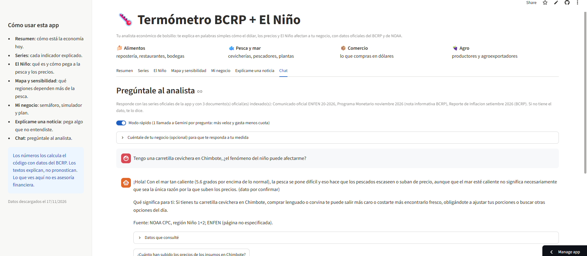
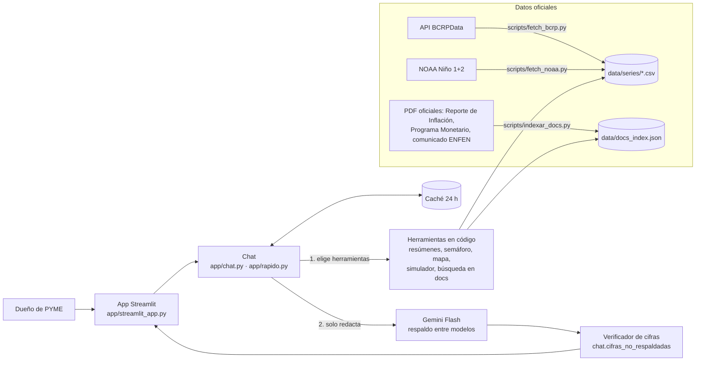

# Termómetro BCRP + El Niño

> **Hacemos que las PYMES peruanas entiendan en 1 minuto cómo el dólar, la inflación y El Niño afectan su negocio, mediante un analista con IA que solo responde con datos oficiales del BCRP y de NOAA, y que verifica cada cifra.**

**Demo:** `[COMPLETAR: URL pública de Streamlit Cloud]` · o en local: ver [Cómo correrlo](#cómo-correrlo) · **Video de respaldo:** `[COMPLETAR: link]`

---

## 1. One-liner

Hacemos **un analista económico de bolsillo** para **dueños de PYMES expuestas al dólar, los precios y El Niño** (importadores, restaurantes, bodegas, pesca y harina de pescado) mediante **un chat con IA conectado a las series oficiales del BCRP y a la temperatura del mar de NOAA**, que explica en lenguaje simple qué significa cada dato para su margen.

## 2. Founder

**Carla Bocanegra**, estudiante de Economía en la Universidad del Pacífico e hija de dos padres emprendedores.

En el mundo corporativo, donde trabajo, las decisiones se toman con analistas que explican qué significan el dólar, la inflación o las tasas. Mis padres, como la mayoría de emprendedores, no tienen ese analista, y les cuesta entender cómo las variables económicas y fenómenos como El Niño afectan su negocio. Este proyecto busca darles esa explicación completa y sencilla, y la intuición que necesitan, para que tomen decisiones informadas.

## 3. Problema

**Quién lo sufre.** El dueño de una PYME que compra en dólares, vende alimentos o depende de la pesca. Toma decisiones de precios, compras e inventario, pero no sabe leer un reporte del BCRP ni tiene un analista.

**Cuánto le cuesta.** Los choques de este año son grandes y se pueden medir con los datos que usa la app:

| Dato oficial (descargado por la app) | Valor |
|---|---|
| Inflación en Lima a 12 meses (oct. 2026) | **5.3 %**, desde 1.4 % hace un año; más alta que el 86 % de los meses desde 2013 |
| Temperatura del mar, región Niño 1+2 (NOAA, semana del 4 nov. 2026) | **+5.6 °C sobre lo normal**, el valor más alto de la serie desde 1981 |
| Pesca de anchoveta, ene.–ago. 2026 vs. 2025 | **−73.1 %** (en El Niño 2023 fue −69.2 %) |
| Dólar interbancario (nov. 2026) | S/ 3.43, +1.8 % en un año |

Para un restaurante con margen de 15 %, que suban los insumos o el dólar puede comerse una parte importante de la ganancia antes de que el dueño se dé cuenta.

**Cómo lo resuelve hoy.** Noticias sueltas, el grupo de WhatsApp del gremio o el contador una vez al mes. Los reportes del BCRP (por ejemplo, el Reporte de Inflación, de más de 100 páginas) son técnicos y BCRPData exige saber qué código de serie buscar.

**Evidencia: 3 conversaciones con usuarios potenciales** → [docs/research/](docs/research/)
`[COMPLETAR: en 2-3 líneas, lo más importante que te dijeron los 3 usuarios.]`

## 4. Solución e insight

Una app web con 7 pestañas y, en el centro, un **chat analista**:

- **Chat:** respondes “¿cómo está el dólar?” o “tengo una planta de harina en Piura, ¿qué tan expuesta estoy?”, y recibes una respuesta corta, con un ejemplo para tu negocio y la fuente (código BCRPData o página del reporte).
- **Semáforo y plan por tipo de negocio:** importador, alimentos, exportador y pesca.
- **El Niño:** temperatura del mar, episodios pasados y su efecto en la pesca, con un mapa por región.
- **Mi negocio:** un simulador de cuánto cambia tu margen si el dólar o los insumos suben.
- **Explícame una noticia:** pegas una noticia económica y te la explica en simple, marcando las cifras que no vienen del texto.
- **Escuchar:** la explicación en audio.

**Insight:** el problema de la IA en economía es que **inventa cifras**. Por eso aquí **la IA nunca calcula**: los números los calcula el código con las series oficiales y la IA solo redacta. Después, un **verificador** revisa que cada número de la respuesta exista en los datos consultados y avisa si no. En nuestra evaluación detectó el 100 % de las cifras inventadas, con 0 falsas alarmas ([docs/evaluacion.md](docs/evaluacion.md)).

## 5. Why now

- **Los LLM ya usan herramientas de forma confiable y barata.** Hace tres años, un modelo que consultara APIs y entregara JSON validado era caro e inestable. Hoy una pregunta cuesta menos de un céntimo de dólar (ver el modelo de negocio).
- **Los datos están abiertos:** la API de BCRPData y el índice semanal de NOAA son públicos y gratuitos.
- **El momento:** 2026 tiene El Niño en curso con el mar en récord e inflación al alza. Es justo cuando una PYME más necesita entender qué está pasando.

## 6. Demo

### Cómo correrlo

```bash
python -m venv .venv && .venv\Scripts\activate      # Mac/Linux: source .venv/bin/activate
pip install -r requirements.txt
cp .env.example .env                                # y pega tu GEMINI_API_KEY
python -m pytest -q                                 # 92 pruebas
streamlit run app/streamlit_app.py
```

Para actualizar los datos: `python scripts/fetch_bcrp.py` y `python scripts/fetch_noaa.py`. Para indexar un PDF del BCRP, ponlo en `data/docs/` y corre `python scripts/indexar_docs.py`. Para publicarlo: [docs/DESPLIEGUE.md](docs/DESPLIEGUE.md).

### Capturas

| Chat analista | El Niño | Mi negocio |
|---|---|---|
|  |  |  |

### Arquitectura



### Modelos y APIs, y por qué

| Qué | Para qué | Por qué |
|---|---|---|
| **Gemini Flash** (`gemini-3.6-flash`; si se agota, prueba 3.8, 3.7 o 3.5) | Redactar respuestas, explicar noticias en JSON | Barato y rápido, soporta herramientas y salidas estructuradas, y tiene plan gratuito para el demo |
| **API BCRPData** | Series de dólar, inflación, PBI, tasa, empleo y pesca | Fuente oficial y gratuita |
| **NOAA CPC** | Temperatura del mar Niño 1+2, semanal | El indicador que usa el ENFEN para vigilar El Niño costero |
| **gTTS** | Audio de las explicaciones | Gratis y sin clave |

**Modo rápido:** el código elige las herramientas por palabras clave y Gemini se llama **una sola vez** por pregunta, en lugar de unas 4. Así gasta 4 veces menos y responde en unos 10 s. Las preguntas que requieren simular el margen usan el modo completo, en el que Gemini elige las herramientas.

## 7. Modelo de negocio

**Quién paga:** el dueño de la PYME.

| Plan | Precio | Incluye |
|---|---|---|
| Gratis | S/ 0 | Series, El Niño, mapa y 5 preguntas al mes |
| **Pro** | **S/ 19 al mes** | Chat ilimitado, semáforo y plan para tu negocio, simulador, explicador de noticias y alertas |

**Costo por usuario** (precio estándar de Gemini 3.6 Flash: US$ 1.50 por millón de tokens de entrada y US$ 7.50 por millón de salida):

| Concepto | Cálculo | Costo |
|---|---|---|
| 1 pregunta en modo rápido | ~1,500 tokens de entrada (medido) + ~400 de salida | ≈ US$ 0.005 |
| Usuario Pro intensivo | 100 preguntas al mes | ≈ US$ 0.53 ≈ **S/ 1.8** |
| Servidor | Streamlit Cloud gratis para el demo; en producción, un servidor de ~US$ 7-25 al mes compartido entre todos los usuarios | < S/ 1 por usuario con 100 usuarios |
| **Total** | | **≈ S/ 2-3 al mes por usuario Pro**, frente a S/ 19 de ingreso (margen bruto ≈ 85 %) |

Las respuestas repetidas salen de la caché y no cuestan tokens.

**Qué sigue:** alertas por WhatsApp cuando el semáforo de tu negocio cambia de color, más regiones y sectores, y una alianza con gremios o cámaras de comercio para llegar a sus asociados.

## 8. Herramientas del curso

| Sesión | Herramienta | Dónde está |
|---|---|---|
| **08** | **LLM con salidas estructuradas y RAG** | `app/noticia.py` (JSON validado con pydantic), `app/estructurado.py`; RAG sobre 3 documentos oficiales (Reporte de Inflación de setiembre 2026, nota del Programa Monetario de noviembre 2026 y comunicado ENFEN N° 20-2026) en `app/docs.py` y `scripts/indexar_docs.py`, con cita de página |
| **05** | **Dashboards** | `app/streamlit_app.py`: 7 pestañas con gráficos de Plotly |
| 03 | APIs | `app/bcrp.py`, `scripts/fetch_bcrp.py`, `scripts/fetch_noaa.py` |
| 06 | Folium | Mapa de regiones pesqueras: `app/geo.py` y la pestaña “Mapa y sensibilidad” |
| 12 | Despliegue y evaluación | `app/evaluacion.py`, `scripts/evaluar.py` → [docs/evaluacion.md](docs/evaluacion.md); [docs/DESPLIEGUE.md](docs/DESPLIEGUE.md) |
| 15 | Texto a voz | `app/voz.py`: botón “Escuchar” |
| 16 | Skills de Claude Code | `.claude/skills/actualizando-series/SKILL.md` |

**Por qué estas dos como principales (08 y 05):** el producto es un analista que no puede inventar datos. Las salidas estructuradas y el RAG obligan a la IA a citar fuentes y a usar los números que entrega el código. El dashboard es donde la PYME ve esos datos sin saber de economía.

Más detalle en [docs/herramientas-curso.md](docs/herramientas-curso.md).

## 9. Qué hizo el agente

Usé Claude como agente de programación. El agente escribió el código; yo puse el problema, los datos, las decisiones de producto y la revisión.

**Lo que hice yo:**
- Elegí el problema y el usuario: PYMES expuestas al dólar, los precios y El Niño.
- Elegí las series del catálogo y verifiqué sus códigos en BCRPData.
- Busqué y elegí los documentos oficiales que lee el chat: el Reporte de Inflación, la nota del Programa Monetario y el comunicado ENFEN.
- Definí el modelo de negocio: cliente PYME, freemium y S/ 19 al mes.
- Probé la app y reporté errores: la lentitud del chat, la cuota agotada de Gemini y las respuestas que mezclaban datos de pesca con un negocio agrícola.
- Tomé decisiones de producto. Por ejemplo, dejé fuera la Encuesta de Expectativas del BCRP para que el chat no se lea como una recomendación de inversión.
- Revisé y entendí las partes principales del código: el verificador de cifras, el chat y el modo rápido.

**Lo que generó el agente:**
- **Fases 1-3:** propuso y programó las funciones de la app. Esto incluye la descarga de BCRPData y NOAA, los resúmenes en lenguaje simple, el semáforo, el plan, el mapa, el simulador, el chat con herramientas, el verificador de cifras, el explicador de noticias, el RAG de documentos, la voz y la evaluación.
- **Con Claude Code:**
  - Completó los archivos que faltaban de la fase 3.
  - Diagnosticó los errores de cuota (429) y de saturación (503) de Gemini.
  - Agregó el respaldo automático entre modelos, la caché de 24 h y el **modo rápido** de 1 llamada (`app/rapido.py`), que usa Gemini Flash-Lite y responde en unos 5 s.
  - Agregó la herramienta de temperatura del mar (`anomalia_nino`), que el chat no podía leer.
  - Corrigió una falsa alarma del verificador con números unidos por guion (como “20-2026”).
  - Escribió los tests de estas partes (`tests/test_respaldo.py`, `tests/test_rapido.py`).
  - Redactó este README a partir de mis respuestas y de los datos de la app.
- **Skill propia:** `.claude/skills/actualizando-series/` le enseña al agente a refrescar las series y validarlas antes del commit.

---

## Honestidad y privacidad

- Solo datos públicos y agregados (BCRP y NOAA). No se guardan datos personales.
- La app no da recomendaciones de inversión: explica riesgos y qué mirar.
- Que El Niño y los precios se muevan juntos no prueba causalidad, y la app lo dice.
- Las series marcadas como no verificadas en `data/catalog.json` se avisan en la respuesta.
- La clave de Gemini va en `.env` o en los Secrets de Streamlit, nunca en el repo.

Licencia: ver [LICENSE](LICENSE).
